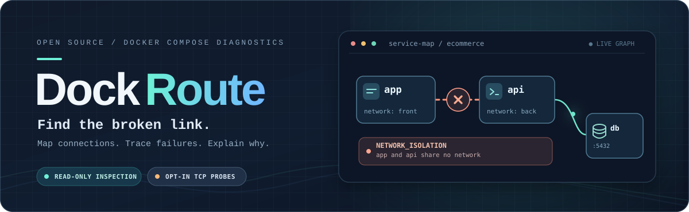
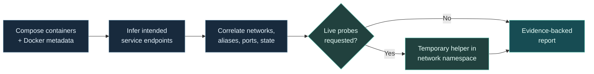

<p align="center">
  
</p>

<p align="center">
  <a href="#quickstart"></a>
  <a href="#how-it-works"></a>
  <a href="#active-probes--safety"></a>
  <a href="LICENSE"></a>
</p>

<p align="center">
  <strong>A networking linter for Docker Compose projects.</strong><br />
  Discover intended service connections, identify likely networking failures, and see the evidence behind every finding.
</p>

<p align="center">
  <a href="#quickstart">Quickstart</a> ·
  <a href="#see-it-in-action">Example</a> ·
  <a href="#how-it-works">How it works</a> ·
  <a href="#measured-results">Evaluation</a> ·
  <a href="#active-probes--safety">Safety</a> ·
  <a href="#contributing--reproducibility">Contribute</a>
</p>

---

### Debug the relationship, not just the container.

Your containers can be running and **still unable to talk to each other**. DockRoute correlates inferred endpoints with Docker networks, aliases, port mappings, and lifecycle state; it then reports observations, likely causes, confidence, and suggested fixes.

No account. No LLM API. No changes to your application containers.

<table>
  <tr>
    <td width="33%" valign="top"><strong>01 / Discover</strong><br /><sub>Infer likely service endpoints from Docker metadata, environment variables, supported configurations, and other bounded signals.</sub></td>
    <td width="33%" valign="top"><strong>02 / Diagnose</strong><br /><sub>Correlate intended connections with networks, aliases, ports, and container state. Optionally run targeted live probes.</sub></td>
    <td width="33%" valign="top"><strong>03 / Explain</strong><br /><sub>Return actionable findings with evidence, confidence, suggested remediation, and a machine-readable report.</sub></td>
  </tr>
</table>

<a id="quickstart"></a>
## ⚡ Quickstart

**Requirements:** Python 3.11+ and access to Docker Engine.

Install using `pipx`:

```sh
pipx install git+https://github.com/osunmo/DockRoute.git
dockroute --version
```

Or install from source:

```sh
python -m pip install .
dockroute --version
```

Inspect an existing Compose project:

```sh
dockroute doctor --project ecommerce
```

Prefer structured output, or need to check a specific endpoint?

```sh
dockroute doctor --project ecommerce --format json
dockroute check backend postgres:5432 --project ecommerce
```

> [!IMPORTANT]
> DockRoute inspects **created Docker Compose containers** (running or stopped), not just a YAML file. Run `doctor` from a Compose directory to automatically select its project. DockRoute does not silently select an unrelated project. Its files-only corpus evaluator is a contributor tool—not a public `lint --file` command or pre-commit integration.

<a id="see-it-in-action"></a>
## ↗ See it in action

Imagine `app` expects to reach `api:8000`, but they live on different networks:

```yaml
services:
  app:
    environment:
      UPSTREAM_URL: http://api:8000
    networks: [front]
  api:
    networks: [back]

networks:
  front: {}
  back: {}
```

**1 · Inspect the existing project**

```sh
dockroute doctor --project myproject
# app -> api:8000: NETWORK_ISOLATION
```

**2 · Fix the Compose configuration yourself** by connecting both services to a shared network, then recreate the project. DockRoute does **not** edit YAML or apply fixes.

**3 · Optionally verify TCP reachability**. The helper image must already be available locally:

```sh
docker pull python:3.12-alpine
dockroute doctor --project myproject --probe
# app -> api:8000: TCP_REACHABLE
# Application protocol readiness was not tested.
```

> [!NOTE]
> For container-to-container communication, use the **container port**, not the published host port. A refused connection alone does not establish its root cause; inspect the reported evidence.

<a id="how-it-works"></a>
## ◇ How it works



Static inspection is read-only. Discovery covers endpoint environment variables, supported URLs and host/port pairs, aliases, healthcheck references, selected mounted configurations, and bounded error-log signatures. `depends_on` is a signal of intended dependency—not proof of traffic or readiness.

In 0.4, bounded mounted-config support covers **Nginx, Prometheus, and Envoy**, along with supported base URI schemes containing driver qualifiers (for example, `postgresql+psycopg://`). Arbitrary formats, templating, and drivers are not supported.

<a id="measured-results"></a>
## ◈ Measured results

**Evidence over inflated claims.** The latest blind real-repository evaluation used **DockRoute 0.3.0**, not DockRoute 0.4.1:

| Metric | Recorded result |
|:--|--:|
| Reviewed endpoint precision · 5 blind repositories | **42/47 (89.4%)** |
| Partial-oracle recall · 5 blind repositories | **42/61 (68.9%)** |
| Partial-oracle recall · 25 development configurations | **88/148 (59.5%)** |
| Root-cause recall · 4 real-project injected faults | **1/4 static · 2/4 active** |

These numbers come from **agent source reviews with partial oracle coverage and unreviewed predictions**. They are **not independently human-validated**, do not estimate population-wide accuracy, and do not establish the accuracy of 0.4 changes. Read the [evaluation method](docs/corpus-evaluation.md) and [small historical baseline](benchmarks/baseline.json).

Third-party replay: not yet done.

The [synthetic scenario suite](docs/diagnostic-accuracy.md) is a **regression harness**. Repeated passes establish that specific implemented behaviors keep working; they are **not real-project accuracy scores**.

<a id="limits"></a>
## △ What DockRoute does—and doesn't—know

| DockRoute can | DockRoute cannot claim |
|:--|:--|
| Infer supported intended endpoints and detect certain configuration or connectivity problems | Discover every dependency in an application |
| Report `NETWORK_ISOLATION` when supported evidence establishes separated networks | Infer arbitrary mounted config, application defaults, templates, or drivers |
| Confirm `TCP_REACHABLE` through a supported active check | Verify HTTP status, database authentication, TLS, or application readiness from TCP success |
| Return `UNKNOWN` when evidence is ambiguous | Turn a clean report into proof that the entire application is healthy |

Resolver-file comparisons help attribute evidence but do not establish equivalence with the application's resolver. `LOOPBACK_ONLY_LISTENER` requires destination-listener evidence. Docker metadata and healthchecks alone cannot produce `TCP_REACHABLE`.

<a id="active-probes--safety"></a>
## ⛨ Active probes & safety

**No probes unless requested.** With `--probe`, DockRoute uses temporary **labeled helper containers** that share the relevant container's network namespace. They use bounded timeouts and resource limits, with ownership-aware cleanup. Helpers are never pulled automatically; the image must already exist locally.

- Automatic active traffic stays within the selected project. An explicit `check HOST:PORT --probe` authorizes the named endpoint.
- Active probes require **Linux containers**, including when running Docker Desktop.
- Abrupt process/host termination or Docker daemon failure may prevent helper cleanup; cleanup failures are reported.
- Docker socket access is **privileged**. Run only in trusted environments.
- DockRoute does **not** alter YAML, change application settings, install tools in application containers, or automatically fix anything.
- Never publish raw normalized Compose files, application logs, environment files, or credentials in bug reports.

<a id="json--exit-codes"></a>
## `{ }` JSON & exit codes

DockRoute 0.4 uses report schema **3.0**. `HEALTHY` was renamed to `TCP_REACHABLE`; the `REACHABLE` status and existing exit-code meanings remain unchanged. See [JSON output and migration](docs/json-output.md) and the [diagnostic code reference](docs/diagnostics.md).

| Exit | Meaning |
|---:|:--|
| `0` | All discovered endpoints completed supported active checks |
| `1` | At least one likely failure or measured network failure |
| `2` | Inconclusive result or no connections discovered |
| `3` | Docker unavailable or inspection failed |
| `4` | Invalid arguments or missing/ambiguous selection |
| `5` | Helper cleanup failed |
| `6` | Active probe infrastructure unavailable |
| `130` | Cancelled |

<a id="contributing--reproducibility"></a>
## ♡ Contributing & reproducibility

Want to make DockRoute better at diagnosing real-world failures? **Add a reproducible Compose fixture—including cases where the correct result is `UNKNOWN`.**

Start with [CONTRIBUTING](CONTRIBUTING.md) and its `expected.yaml` fixture contract. The [regression matrix](docs/diagnostic-accuracy.md) includes topology, ports, HTTP failure controls, restart loops, disappearing containers, and recovery.

Keep detailed reports and safe raw fixture evidence in CI artifacts or release assets, **not Git**. Only the compact historical baseline lives in the repository. Release publication requires the documented [release gates](docs/releasing.md): exact source/version, green hosted Linux Docker validation, privacy checks, and matching evidence.

Standalone native binaries can be built with:

```sh
python scripts/build_binary.py --output outputs
```

See [packaging](docs/cli-startup.md) for details.

---

<p align="center">
  <sub>Made for the moment when every container says “running” but nothing connects.</sub><br />
  <sub>MIT licensed · Local-first · No account or LLM API required</sub>
</p>
